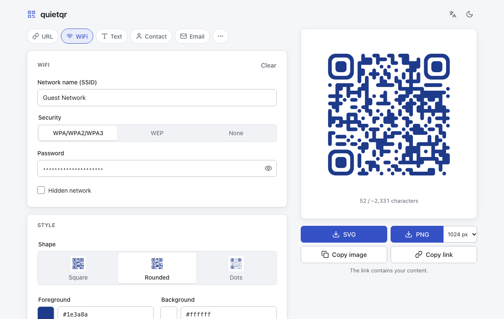

# quietqr

Private, self-hostable QR code generator. Runs entirely in your browser: no backend, no
tracking, no account, no requests to anyone else.

**Demo:** <https://simonhedrich.github.io/quietqr/>

<picture>
  <source media="(prefers-color-scheme: dark)" srcset="docs/screenshot-dark.png" />
  
</picture>

## Why

Hosted QR generators see everything you encode (WiFi passwords, contacts, links), often want
an account, and sometimes turn your code into a tracking redirect. quietqr does the encoding
in your browser and ships as a tiny static site you can run yourself.

- **Content first:** URL, WiFi, Text, Contact (vCard), Email, Phone, SMS, Location and Event
  templates, front and centre.
- **Few, good options:** three shapes, colors with curated presets, an optional logo,
  error correction (Auto by default). Every option combination is decode-tested.
- **Scannability warnings** for low contrast, inverted colors, a logo too large for the
  error correction, and very dense codes.
- **Export** as SVG or PNG (512–2048 px), copy to the clipboard, or share a link that
  carries the content in the URL hash, never on a server.
- English and German, light and dark, keyboard accessible.

## Run it

```sh
docker run -d --name quietqr -p 8080:8080 --read-only ghcr.io/simonhedrich/quietqr:latest
```

Then open <http://localhost:8080>. With Compose:

```yaml
services:
  quietqr:
    image: ghcr.io/simonhedrich/quietqr:latest
    ports:
      - '8080:8080'
    read_only: true
    cap_drop: [ALL]
    security_opt: ['no-new-privileges:true']
    restart: unless-stopped
```

The image is about 4 MB ([static-web-server](https://static-web-server.net/) on scratch),
runs as a non-root user and idles at about 7 MiB of memory. It works behind any reverse
proxy and under a sub-path; the app only uses relative URLs.

You can also serve the `dist/` folder from `npm run build` with any static web server.

## Privacy

- Everything happens in your browser. The server only delivers static files.
- The Content Security Policy (`default-src 'none'; script-src 'self'; style-src 'self';
img-src 'self' data: blob:; connect-src 'none'; …`) lets the page load scripts and styles
  only from its own origin and forbids it to connect anywhere. You can check it in your
  browser's developer tools. The Docker image sends it as a header; GitHub Pages can't set
  headers, so the same policy is also in a `<meta>` tag (there, framing protection and a
  few other headers aren't available).
- No cookies, no analytics, no fonts or scripts from CDNs.
- localStorage keeps only your style settings, language and theme, never the content or
  the logo.
- The content only ends up in a URL if you click "Copy link"; the link is removed from the
  address bar as soon as you edit again. Downloads are named `quietqr-<type>.png`, never
  after the content.

## Development

Requires Node 26 (see `.nvmrc`).

```sh
npm install
npm run dev        # dev server on http://localhost:5173
npm run check      # svelte-check + TypeScript
npm run lint       # ESLint + Prettier
npm test           # unit tests and decode-based scan tests (Vitest)
npm run build      # production build in dist/
npm run test:e2e   # Playwright smoke test (builds and serves dist/)
npm run format     # Prettier --write
docker build -t quietqr .
```

See [CONTRIBUTING.md](CONTRIBUTING.md) for how the code is organised and how to add a
template or a language. The [docs](docs/) explain the [goals](docs/brief.md), the
[features](docs/features.md), the [technical decisions](docs/decisions.md) and the
[roadmap](docs/roadmap.md), including where help is welcome (device testing, translations).

## Credits

- Inspired by [mini-qr](https://github.com/lyqht/mini-qr); quietqr is a separate,
  from-scratch project with a smaller option set.
- QR encoding by [uqr](https://github.com/unjs/uqr) (MIT), a port of Nayuki's
  [QR Code generator](https://github.com/nayuki/QR-Code-generator).
- Icons adapted from [Lucide](https://lucide.dev) (ISC License).

## License

[MIT](LICENSE)
